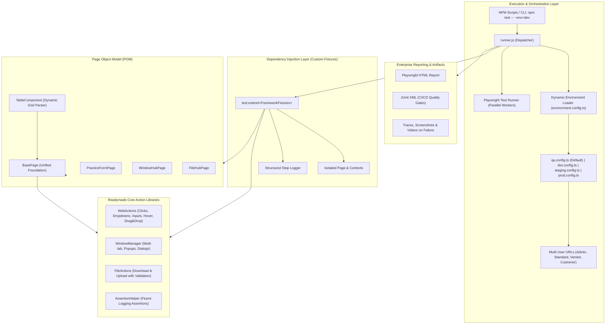

# Enterprise Playwright UI Automation Framework

[](https://playwright.dev/)
[](https://www.typescriptlang.org/)
[](#)
[](#)
[](#)

---

## 🏛️ 1. Architecture Overview

Designed by and for **Principal Test Architects**, this framework delivers an enterprise-grade UI automation solution built on **Playwright** and **TypeScript**. It features clean abstraction layers, resilient DOM interactions, multi-environment support, grep-based test categorization, high-concurrency parallel execution, and built-in action libraries.



---

## 📁 2. Directory Structure

```text
playwright-enterprise-framework/
├── runner.js                     # Unified cross-platform CLI runner with fallback defaults
├── .gitignore                    # Artifact and node_modules exclusions
├── package.json                  # Dependencies & lifecycle execution scripts (0 runtime deps)
├── tsconfig.json                 # TypeScript compiler & path alias settings
├── playwright.config.ts          # Central Playwright runner config (workers, grep, reporters)
├── README.md                     # Comprehensive architecture documentation
├── src/
│   ├── config/
│   │   ├── envs/                 # Pure TypeScript Environment Configurations
│   │   │   ├── env.types.ts      # Strongly-typed environment & user profile interfaces
│   │   │   ├── qa.config.ts      # QA environment preset (Default fallback)
│   │   │   ├── dev.config.ts     # Dev environment preset
│   │   │   ├── staging.config.ts # Staging environment preset
│   │   │   └── prod.config.ts    # Production synthetic monitoring preset
│   │   ├── environment.config.ts # Dynamic environment loader & multi-user URL manager
│   │   └── test-data.config.ts   # File paths, timeouts, and constant configurations
│   ├── core/
│   │   ├── base.page.ts          # Abstract BasePage integrating all action libraries
│   │   ├── web-actions.ts        # Readymade library: click, safeClick, inputs, dropdowns, alerts
│   │   ├── window-manager.ts     # Readymade library: multi-tab, popups, window switching
│   │   ├── file-actions.ts       # Readymade library: download, upload, file size validation
│   │   └── assertion-helper.ts   # Fluent assertion wrappers with integrated logging
│   ├── fixtures/
│   │   └── test.fixture.ts       # Dependency injection container via test.extend
│   ├── pages/
│   │   ├── components/
│   │   │   └── table.component.ts# Reusable dynamic web table component
│   │   ├── practice-form.page.ts # Page object for inputs, dropdowns, and checkboxes
│   │   ├── window-hub.page.ts    # Page object for tabs, popups, and dialogs
│   │   └── file-hub.page.ts      # Page object for uploads and downloads
│   └── utils/
│       ├── logger.ts             # Structured multi-level logger with Playwright step attachment
│       └── test-helpers.ts       # Random strings, emails, dates, and formatting
├── test-data/
│   ├── downloads/                # Directory for downloaded test files
│   └── uploads/                  # Directory for test upload files
└── tests/
    ├── e2e/
    │   ├── user-actions.spec.ts  # Tests for single/double/right click, typing, tables
    │   ├── dropdown-selection.spec.ts # Tests for native, multi-select, and custom dropdowns
    │   ├── window-handling.spec.ts    # Tests for tabs, popups, alerts, confirms, prompts
    │   ├── file-operations.spec.ts    # Tests for file download, upload, validation
    │   └── multi-env.spec.ts     # Tests for environment resolution & feature flags
    └── test-sandbox/             # Local deterministic HTML test pages
        ├── index.html            # Inputs, native/custom dropdowns, tables
        ├── windows.html          # Tabs, popups, and JavaScript dialogs
        └── files.html            # File download and upload triggers
```

---

## 🧰 3. Readymade Core Action Libraries

### 3.1. `WebActions` (`src/core/web-actions.ts`)
Encapsulates direct, auto-waiting DOM actions without redundant artificial delays or dual `waitFor` wrappers. Fully supports native Playwright `LocatorClickOptions` (`delay`, `force`, `clickCount`, etc.):

| Method | Description |
|---|---|
| `click(locator, description, options)` | Clicks an element directly. Auto-waits natively and accepts native `delay`, `force`, `clickCount`, etc. |
| `safeClick(locator, description, timeout)` | Non-throwing click attempt; returns `boolean` for conditional UI flows. |
| `doubleClick(locator, description, options)` | Double clicks on an element directly with native options. |
| `rightClick(locator, description, options)` | Performs context-menu right click with native options. |
| `forceClick(locator, description)` | Bypasses DOM overlays directly via `{ force: true }`. |
| `retryClick(locator, desc, retries)` | Retries clicking when transient animations or overlays occur. |
| `enterText(locator, text, desc, opts)` | Fills text directly with auto-waiting. |
| `clearAndType(locator, text, desc, delay)` | Clears text and types sequentially with configurable keypress delay. |
| `selectByValue(locator, value)` | Selects `<select>` option by `value` attribute. |
| `selectByLabel(locator, label)` | Selects `<select>` option by visible label text. |
| `selectByIndex(locator, index)` | Selects `<select>` option by 0-based index. |
| `selectMultiple(locator, values)` | Selects multiple options in `<select multiple>`. |
| `selectCustomDropdown(...)` | Clicks custom div/ul/li container, optionally filters, and selects option. |
| `check(locator)` / `uncheck(locator)` | Ensures checkbox or radio button state. |
| `handleDialog(action, promptText)` | Auto-intercepts standard JS `alert`, `confirm`, or `prompt`. |
| `hover(locator)` / `dragAndDrop(...)` | Mouse gestures and drag-and-drop operations. |
| `navigateToUser(role, subpath)` | Navigates directly to role-specific portal (e.g. `admin`, `vendor`, `customer`). |

### 3.2. `WindowManager` (`src/core/window-manager.ts`)
Simplifies tab, popup, and window switching:

| Method | Description |
|---|---|
| `waitForNewTab(triggerAction)` | Listens for `page` event, triggers action, waits for DOM load, and activates new tab. |
| `switchToPageByIndex(index)` | Switches to open page by 0-based index and brings to front. |
| `switchToPageByTitle(titlePattern)` | Searches all open pages matching title string or regex and activates it. |
| `switchToPageByUrl(urlPattern)` | Searches all open pages matching URL string or regex and activates it. |
| `closePageAndSwitchBack(page, fallback)` | Closes target tab and brings parent tab back to front safely. |
| `getPagesCount()` | Returns total open tab count in current context. |

### 3.4. `ApiClient` (`src/core/api-client.ts`)
Enterprise REST API client wrapping Playwright's native `APIRequestContext` for API and hybrid UI+API testing:

| Method | Description |
|---|---|
| `get(endpoint, options)` | Executes HTTP GET with query params, headers, and returns encapsulated response. |
| `post(endpoint, data, options)` | Executes HTTP POST with JSON body payload. |
| `put(endpoint, data, options)` | Executes HTTP PUT with update payload. |
| `patch(endpoint, data, options)` | Executes HTTP PATCH for partial updates. |
| `delete(endpoint, options)` | Executes HTTP DELETE request. |
| `setAuthToken(token, scheme)` | Sets Bearer token or authorization header for chained requests. |
| `response.expectStatus(code)` | Asserts HTTP response status code with detailed diagnostic failure messages. |
| `response.expectSuccess()` | Asserts HTTP 2xx success status. |

#### REST API Example
```typescript
import { test, expect } from '@fixtures/test.fixture';

test('Create and verify user via REST API @api', async ({ apiClient }) => {
  const response = await apiClient.post('/api/users', {
    name: 'Carlos Ray',
    role: 'Principal SDET',
  });

  response.expectStatus(201);
  response.expectSuccess();
  expect(response.data.id).toBeDefined();
  expect(response.durationMs).toBeLessThan(1000);
});
```

---

## 🌐 4. Zero-Dependency Multi-Environment & Multi-User Architecture

The framework eliminates external dependencies like `dotenv` by using **pure TypeScript configuration files ending in `.ts`** under `src/config/envs/`:
- `qa.config.ts`: QA environment preset (**default fallback**)
- `dev.config.ts`: Dev environment preset
- `staging.config.ts`: Staging environment preset
- `prod.config.ts`: Production synthetic monitoring preset

### 4.1. Dynamic Configuration Loader
Loaded dynamically by [environment.config.ts](file:///C:/Users/Shubi/.gemini/antigravity/scratch/playwright-enterprise-framework/src/config/environment.config.ts) based on CLI arguments (e.g. `--env=dev`). If no environment flag is specified, it automatically falls back to `qa.config.ts`.

### 4.2. Multi-User & Role-Based URL Support
Enterprise architectures frequently maintain separate portals for distinct user roles (e.g., Administrator, Standard User, Vendor, Customer). Each `.ts` configuration declares user-specific URLs:

```typescript
// Inside src/config/envs/qa.config.ts
export const QA_CONFIG: EnvironmentConfigData = {
  envName: 'qa',
  baseUrl: 'https://qa.example.com',
  apiBaseUrl: 'https://api-qa.example.com',
  users: {
    admin: {
      role: 'admin',
      portalUrl: 'https://admin-qa.example.com',
      username: 'qa-admin@example.com',
    },
    standard: {
      role: 'standard',
      portalUrl: 'https://portal-qa.example.com',
    },
    vendor: {
      role: 'vendor',
      portalUrl: 'https://vendor-qa.example.com',
    },
    customer: {
      role: 'customer',
      portalUrl: 'https://app-qa.example.com',
    },
  },
};
```

### 4.3. Multi-User Navigation in Tests
```typescript
// 1. Direct navigation via WebActions
await webActions.navigateToUser('admin', '/dashboard');

// 2. Direct navigation via BasePage in Page Objects
await page.navigateAsUser('vendor', '/invoices');

// 3. Resolve user URL with custom subpaths
const customerUrl = env.getUserUrl('customer', '/account/settings');
```

---

## 🏷️ 5. Grep Tag Support

Tags are defined using Playwright's native tagging syntax in `test()` or `test.describe()`:
- `@smoke`: Critical health check smoke tests
- `@regression`: Full regression test suite
- `@sanity`: High-level sanity checks
- `@actions`: Click, input, and table actions
- `@dropdowns`: Dropdown selection tests
- `@windows`: Window, tab, popup, and alert tests
- `@files`: File download and upload tests
- `@env`: Environment validation tests

### Execution Commands by Tag
```bash
# Run all smoke tests
npm run test:smoke
# Equivalent to: npx playwright test --grep @smoke

# Run regression tests in QA environment
npm run test:qa:regression

# Run file operations tests
npm run test:files

# Run window and dialog tests
npm run test:windows

# Run tests matching smoke OR regression
npx playwright test --grep "@smoke|@regression"

# Run regression tests EXCLUDING flaky tests
npx playwright test --grep @regression --grep-invert @flaky
```

---

## ⚡ 6. Parallel Execution & Worker Allocation

Parallelism is configured out-of-the-box in `playwright.config.ts`:
- `fullyParallel: true`: Test files and individual test cases run concurrently.
- `workers`: Dynamically allocates workers (4 workers locally, 2 workers in CI pipelines, or customizable via `WORKERS` environment variable).
- `retries`: Set to 2 retries in CI and 0 locally for rapid debugging.

```bash
# Execute tests with 4 parallel workers
npm run test:parallel

# Specify custom worker concurrency
cross-env WORKERS=8 npx playwright test
```

---

## 🧩 7. Dependency Injection Fixtures & Path Aliases

### 7.1. TypeScript Path Aliases
To avoid brittle and verbose relative (`../../src/...`) or absolute paths, the framework implements standardized TypeScript path aliases defined in `tsconfig.json`:

```typescript
// Config & Constants
import { ENV_CONFIG } from '@config/environment.config';
import { TEST_PATHS } from '@config/test-data.config';

// Core Action Libraries
import { WebActions } from '@core/web-actions';
import { WindowManager } from '@core/window-manager';
import { FileActions } from '@core/file-actions';
import { AssertionHelper } from '@core/assertion-helper';
import { BasePage } from '@core/base.page';

// Fixtures & Test Runner
import { test, expect } from '@fixtures/test.fixture';

// Page Objects & Components
import { PracticeFormPage } from '@pages/practice-form.page';
import { TableComponent } from '@pages/components/table.component';

// Utilities
import { Logger } from '@utils/logger';
import { TestHelpers } from '@utils/test-helpers';
```

### 7.2. Test Execution with Fixtures
Instead of manually instantiating page objects and loggers, the framework leverages custom Playwright fixtures (`@fixtures/test.fixture`):

```typescript
import { test, expect } from '@fixtures/test.fixture';

test('Verify dropdown selection', async ({ practiceFormPage, assertHelper }) => {
  await practiceFormPage.open();
  await practiceFormPage.selectCountry('United Kingdom');
  await assertHelper.assertContainsText(
    practiceFormPage.dropdownStatusBadge,
    'Selected Country: United Kingdom (uk)'
  );
});
```

---

## 📊 8. Reports & Artifacts

After test execution, comprehensive reports and failure diagnostics are automatically generated:

```bash
# Open interactive Playwright HTML report
npm run report
```

### Artifact Retention Policy
- **HTML Report**: Full step-by-step timeline, console logs, and attachments.
- **JUnit XML**: Stored at `test-results/junit-results.xml` for CI pipeline integration.
- **JSON Summary**: Stored at `test-results/summary-results.json`.
- **Traces**: Captured on failure (`retain-on-failure`) with DOM snapshot replay.
- **Screenshots**: Automatically captured on test failure (`only-on-failure`).
- **Videos**: Captured on first retry (`on-first-retry`).

---

## 🚀 9. Streamlined Runtime Commands & Default Fallbacks

The framework uses a unified launcher ([runner.js](file:///C:/Users/Shubi/.gemini/antigravity/scratch/playwright-enterprise-framework/runner.js)) with **safe, intelligent default fallbacks**. If you don't supply `--env` or `--grep`, the framework defaults safely without throwing errors:

### Default Fallbacks & Runtime Overrides Matrix
| Parameter | Default Fallback Value | Runtime CLI Override Flags |
|---|---|---|
| **Environment** | `qa` (`src/config/envs/qa.config.ts`) | `--env=dev` \| `--env=staging` \| `--env=prod` |
| **UI Base URL** | Inherited from active environment preset | `--base-url="https://..."` \| `-u "https://..."` |
| **API Base URL** | Inherited from active environment preset | `--api-base-url="https://..."` |
| **Tag Filter** | `@smoke` (fast sanity health check) | `--grep="@regression"` \| `--grep="@api"` \| `--all` |
| **Browser Project** | `chromium` | `--project=firefox` \| `--project=webkit` |
| **Parallel Concurrency** | `4 workers` | `--workers=2` \| `--workers=8` |

---

### Command Examples

```bash
# 1. Zero Arguments (Defaults to QA environment + @smoke tests)
npm test

# 2. Override Base URL on the Fly (e.g. Ephemeral preview branch / PR deployment)
npm test -- --base-url="https://pr-99.preview.company.com"

# 3. Override Environment AND Base URL
npm test -- --env=staging --base-url="https://custom-staging.domain.com"

# 4. Override API Base URL for API Testing
npm test -- --api-base-url="https://custom-api.domain.com" --grep="@api"

# 5. Override Tag Filter Only (Runs full @regression against QA)
npm test -- --grep="@regression"

# 6. Run ALL Tests (Bypasses tag filtering)
npm test -- --all
npm test -- --env=staging --all

# 7. Full Custom Override
npm test -- --env=dev --base-url="https://dev-branch.domain.com" --grep="@regression" --workers=2

# 6. Interactive UI & Reports
npm run test:ui
npm run test:debug
npm run report
```

### Minimal `package.json` Scripts
```json
"scripts": {
  "test": "node runner.js",
  "test:ui": "node runner.js --ui",
  "test:debug": "node runner.js --debug",
  "report": "playwright show-report"
}
```

---

## 🔄 10. CI/CD Integration Example (GitHub Actions)

```yaml
name: Enterprise Playwright E2E Tests

on:
  push:
    branches: [ main, develop ]
  pull_request:
    branches: [ main ]

jobs:
  test:
    timeout-minutes: 60
    runs-on: ubuntu-latest
    steps:
    - uses: actions/checkout@v4
    - uses: actions/setup-node@v4
      with:
        node-version: 20
        cache: 'npm'
    - name: Install dependencies
      run: npm ci
    - name: Install Playwright Browsers
      run: npx playwright install --with-deps
    - name: Run Smoke Tests on QA
      run: npm run test:qa:smoke
    - name: Upload Test Report
      if: always()
      uses: actions/upload-artifact@v4
      with:
        name: playwright-report
        path: playwright-report/
        retention-days: 30
```
